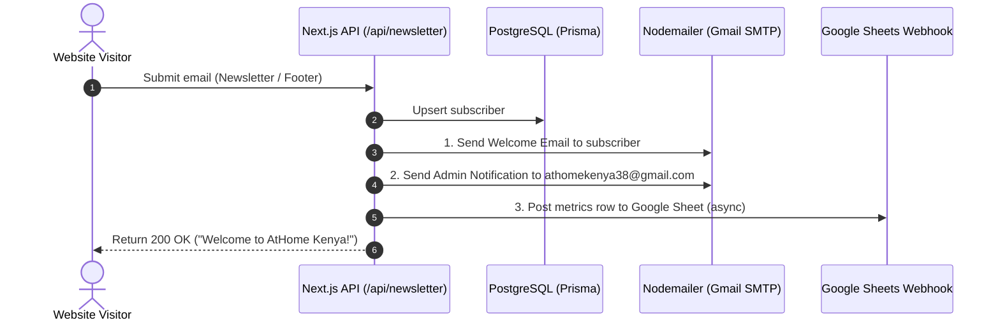

# Google Sheets & Mailing Setup Guide

This guide explains how to connect your AtHome Kenya lead capture and newsletter system to Google Sheets (for real-time metrics tracking) and configure email delivery to `athomekenya38@gmail.com`.

---

## 1. Setting up Real-Time Google Sheets Sync

You can synchronize every newsletter subscriber, contact inquiry, consultation, and job application directly into Google Sheets:

### Step 1: Create a Google Sheet
1. Open [Google Sheets](https://sheets.new) and name the spreadsheet (e.g. `AtHome Kenya Leads & Metrics`).
2. Go to **Extensions > Apps Script** in the top menu.

### Step 2: Paste the Script
1. Delete any sample code in the editor (`Code.gs`).
2. Open [`docs/GOOGLE_APPS_SCRIPT.gs`](file:///c:/Users/adohj/Desktop/ahk/docs/GOOGLE_APPS_SCRIPT.gs), copy the full content, and paste it into the editor.
3. Click the **Save** (disk) icon.

### Step 3: Deploy as a Web App
1. Click the blue **Deploy** button (top right) > **New deployment**.
2. Click the gear icon beside "Select type" and select **Web app**.
3. Fill in the deployment details:
   - **Description**: `AtHome Kenya Webhook`
   - **Execute as**: `Me (your email)`
   - **Who has access**: `Anyone` *(Crucial: must be set to Anyone so Next.js can send submissions)*
4. Click **Deploy**.
5. Grant permissions if prompted by Google.
6. Copy the **Web App URL** (it ends with `/exec`).

### Step 4: Add to `.env`
Paste the URL in your `.env` file:
```env
GOOGLE_SHEET_WEBHOOK_URL="https://script.google.com/macros/s/YOUR_DEPLOYMENT_ID/exec"
```

---

## 2. Setting up Gmail SMTP for Email Dispatch

To send both the **Welcome Email** to the subscriber and the **Admin Notification** to `athomekenya38@gmail.com`:

### Step 1: Generate a Gmail App Password
1. Log into your Google Account for `athomekenya38@gmail.com`.
2. Go to [Google Account Security](https://myaccount.google.com/security).
3. Ensure **2-Step Verification** is turned **ON**.
4. In the search bar at the top of the Google Account page, search for **App passwords**.
5. Create a new App password:
   - Name: `AtHome Kenya Website`
6. Google will generate a 16-letter password (e.g. `abcd efgh ijkl mnop`).

### Step 2: Configure in `.env`
In your `.env` file, update:
```env
SMTP_HOST="smtp.gmail.com"
SMTP_PORT="587"
SMTP_SECURE="false"
SMTP_USER="athomekenya38@gmail.com"
SMTP_PASS="your-16-character-app-password"
NOTIFICATION_EMAIL="athomekenya38@gmail.com"
CAREERS_NOTIFICATION_EMAIL="athomekenya38@gmail.com"
```

---

## 3. How the Mailing & Metrics Flow Works



---

## 4. Verification & Testing

You can test the implementation anytime using our test script:
```bash
node scripts/testNewsletter.mjs
```
