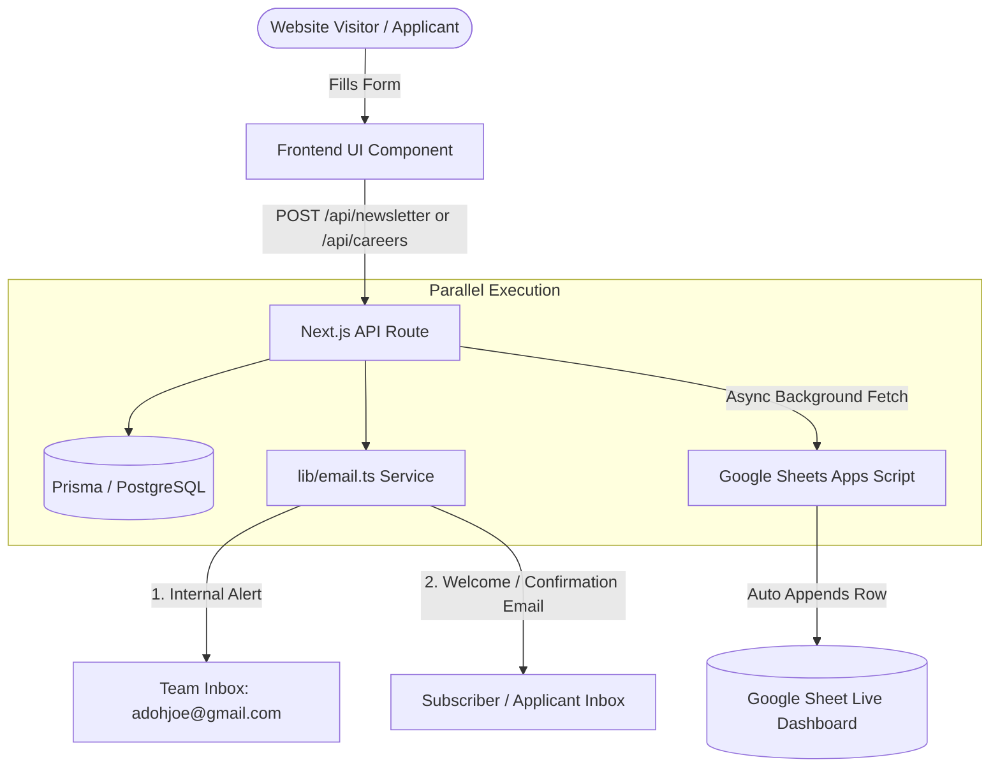

# AtHome Kenya — Mailing & Metrics System Documentation

Comprehensive technical and operational guide for the mailing, lead capture, and metrics synchronization architecture built for **AtHome Kenya (`ahk`)**.

---

## 1. System Architecture Overview

The mailing system uses a **decoupled, dual-action architecture** modeled after high-conversion lead workflows. Whenever a user interacts with a form on the website (e.g. Newsletter or Careers Application), the system simultaneously handles database storage, internal admin alerts, customer confirmations, and Google Sheets metrics synchronization.



---

## 2. Supported Email Flows

### Flow A: Newsletter & Care Updates Subscription
- **Trigger**: Visitor submits email via [NewsletterSignup.tsx](file:///c:/Users/adohj/Desktop/ahk/components/home/NewsletterSignup.tsx) or [Footer.tsx](file:///c:/Users/adohj/Desktop/ahk/components/layout/Footer.tsx).
- **API Route**: [app/api/newsletter/route.ts](file:///c:/Users/adohj/Desktop/ahk/app/api/newsletter/route.ts)
- **Actions**:
  1. **Prisma DB**: Upserts the email into the `NewsletterSubscriber` table.
  2. **Subscriber Welcome Email (`sendNewsletterWelcomeEmail`)**: Sends a branded HTML welcome email introducing AtHome Kenya's home caregiving services, care guides, and direct WhatsApp concierge button (`+254 705 320618`).
  3. **Admin Alert (`sendNewsletterAdminNotification`)**: Alerts `NOTIFICATION_EMAIL` (e.g. `adohjoe@gmail.com`) with the subscriber email, submission source (e.g. `homepage_newsletter`, `footer_newsletter`), and timestamp.
  4. **Google Sheets**: Appends a row into the `Newsletter` tab in Google Sheets.

### Flow B: Careers & Job Application
- **Trigger**: Healthcare professional submits their application and uploads documents on the `/careers` page.
- **API Route**: [app/api/careers/route.ts](file:///c:/Users/adohj/Desktop/ahk/app/api/careers/route.ts)
- **Actions**:
  1. **Prisma DB**: Records application details in the `JobApplication` table.
  2. **Internal HR Alert**: Dispatches full application details with attached files (CV, Cover Letter, Nursing Council License, ID) to `CAREERS_NOTIFICATION_EMAIL`.
  3. **Applicant Confirmation Email (`sendJobApplicationApplicantConfirmation`)**: Sends the candidate a formal confirmation email acknowledging their submission, detailing the review process, and providing talent team contact information.
  4. **Google Sheets**: Appends applicant summary into the `Careers` tab in Google Sheets.

---

## 3. Email Templating & Design Specifications

All email templates in [lib/email.ts](file:///c:/Users/adohj/Desktop/ahk/lib/email.ts) follow email design best practices:
- **Table-based Responsive Layout**: Compatible with Gmail, Apple Mail, Outlook, and mobile clients.
- **Brand Palette**:
  - Primary Green: `#2D6A4F` (Forest Sage)
  - Secondary Accent: `#1B4332` (Deep Forest)
  - Background Neutral: `#F8F9FA` & `#F4F6F0` (Soft Sage tint)
  - Primary Text: `#1F2421` (Near-black)
  - WhatsApp CTA Button: `#25D366`
- **Dynamic Variable Injection**: Automatically populates site URL, WhatsApp click-to-chat links, applicant names, position titles, and timestamps.

---

## 4. Google Sheets & Live Metrics Synchronization

For non-technical team members who need to review leads and analytics without accessing SQL databases, the system includes a dedicated Google Apps Script webhook backend.

### Google Apps Script Features ([docs/GOOGLE_APPS_SCRIPT.gs](file:///c:/Users/adohj/Desktop/ahk/docs/GOOGLE_APPS_SCRIPT.gs)):
1. **Auto Tab Generation**: Automatically creates and styles formatted sheet tabs (`Newsletter`, `Contacts`, `Consultations`, `Careers`).
2. **Frozen Headers**: Green-accented bold header rows.
3. **East Africa Time (EAT) Timestamping**: Formats dates into `GMT+3` (Nairobi time).

### Setup Instructions:
1. Create a Google Sheet at [sheets.new](https://sheets.new).
2. Go to **Extensions > Apps Script**, paste the content of `docs/GOOGLE_APPS_SCRIPT.gs`, and click **Deploy > New deployment**.
3. Select **Web app** with access set to **Anyone**, and copy the `/exec` URL into `.env`:
   ```env
   GOOGLE_SHEET_WEBHOOK_URL="https://script.google.com/macros/s/YOUR_SCRIPT_ID/exec"
   ```

---

## 5. Environment Variables & Production Checklist

| Environment Variable | Description | Example / Recommended Value |
| :--- | :--- | :--- |
| `SMTP_HOST` | SMTP server host | `smtp.titan.email` |
| `SMTP_PORT` | SMTP server port | `465` (SSL) |
| `SMTP_SECURE` | TLS / SSL flag | `true` (for 465) |
| `SMTP_USER` | Sending email address | `info@athomekenya.com` |
| `SMTP_PASS` | Titan Mail App Password | `APW1T10I6J1WA7LZ` |
| `SMTP_FROM` | Outgoing Display From | `info@athomekenya.com` |
| `NOTIFICATION_EMAIL` | Inbox for general lead alerts | `adohjoe@gmail.com, info@athomekenya.com` |
| `CAREERS_NOTIFICATION_EMAIL` | Inbox for job applicant CVs | `adohjoe@gmail.com, info@athomekenya.com` |
| `GOOGLE_SHEET_WEBHOOK_URL` | Live Google Sheets webhook | `https://script.google.com/macros/s/.../exec` |
| `NEXT_PUBLIC_APP_URL` | Production website base URL | `https://www.athomekenya.com` |
| `NEXT_PUBLIC_WHATSAPP_NUMBER` | Clinical concierge WhatsApp | `254705320618` |

---

## 6. Testing & Maintenance

- **Automated Email Smoke Test**:
  ```bash
  node scripts/testNewsletter.mjs
  ```
- **Type Checking**:
  ```bash
  npx tsc --noEmit
  ```
- **Production Build Verification**:
  ```bash
  npm run build
  ```
